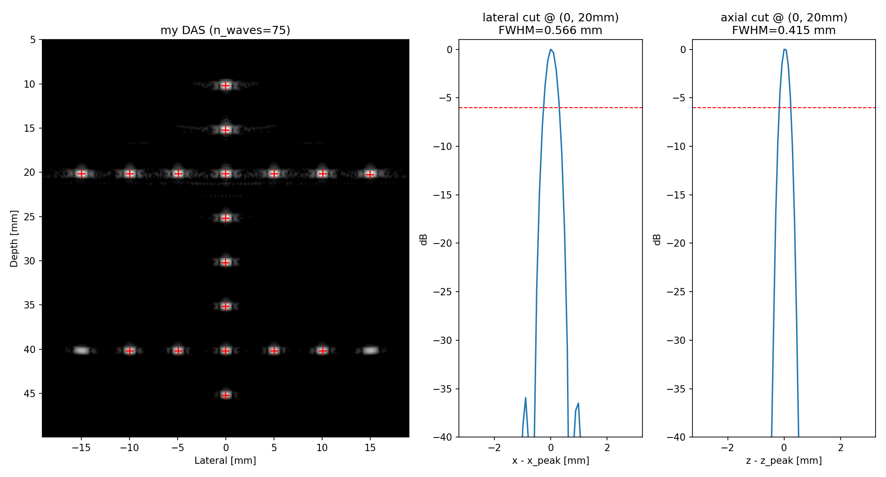

# PICMUS Plane-Wave DAS Beamformer (Python)

초음파 평면파(plane-wave) 채널 데이터로부터 **Delay-and-Sum(DAS) 빔포밍을 Python/NumPy로 직접 구현**하고,
그 결과를 PICMUS 공개 데이터셋과 USTB 참조 영상에 대해 **정량 지표(FWHM, CR/CNR/gCNR)로 검증**한 프로젝트입니다.

MATLAB 기반 USTB(Ultrasound Toolbox)의 `midprocess.das` 로직을 참고해 포팅했으며,
MATLAB 라이선스 없이 `.uff`(HDF5) 파일을 직접 읽어 전 과정을 Python으로 재현했습니다.

---

## 핵심 결과

75개 평면파 coherent compounding, dynamic receive apodization(F# = 1.7, Tukey 50%) 기준
— 동일 데이터에 동봉된 **USTB 참조 빔포밍 결과와 비교**했습니다.

| 지표 | 내 구현 | USTB 참조 | 비고 |
|---|---|---|---|
| Axial FWHM (18 points 평균) | **0.418 mm** (1.41 λ) | 0.417 mm (1.41 λ) | 차이 0.2 % |
| Lateral FWHM (18 points 평균) | **0.584 mm** (1.97 λ) | 0.658 mm (2.23 λ) | 11 % 더 좁음 (§4.1) |
| CR | **−39.76 dB** | −39.56 dB | 차이 0.21 dB |
| CNR | **0.800** | 0.797 | 차이 0.4 % |
| gCNR | **0.9982** | 0.9980 | 차이 0.02 % |
| dB 영상 NRMSE vs 참조 | **0.0428** | — | 0에 가까울수록 일치 |

→ 축방향 해상도와 대조도 지표가 참조 구현과 **소수점 둘째 자리까지 일치**하므로,
지연 계산·보간·채널 합산·compounding 전 단계가 올바르게 구현되었다고 판단했습니다.

| 해상도 검증 | 대조도 검증 |
|---|---|
|  |  |

---

## 1. 데이터

[PICMUS](https://www.creatis.insa-lyon.fr/Challenge/IEEE_IUS_2016/) (Plane-wave Imaging Challenge in
Medical UltraSound, IEEE IUS 2016) 시뮬레이션 데이터 2종을 사용했습니다.

| 항목 | 값 |
|---|---|
| 프로브 | L11-4v, 128 elements, pitch 0.30 mm, aperture 38.1 mm |
| 송신 | 평면파 75개, 조향각 −16° ~ +16° |
| 샘플링 | fs = 20.832 MHz, f0 = 5.208 MHz (fs/4), c = 1540 m/s, λ = 0.2957 mm |
| Raw 데이터 | (75 waves, 128 channels, 1527 samples) |
| 스캔 격자 | 387 (x: −19.05 ~ 19.00 mm) × 609 (z: 5.00 ~ 49.95 mm), 약 236k pixels |
| `..._resolution_distortion.uff` | point target 팬텀 → 해상도(FWHM) 측정용 |
| `..._contrast_speckle.uff` | 무에코 낭종 + speckle 팬텀 → 대조도(CR/CNR/gCNR) 측정용 |

두 파일 모두 채널 데이터와 함께 **USTB가 직접 빔포밍한 `beamformed_data`(참조 영상)** 를 담고 있어,
별도 구현 없이 내 결과와 1:1로 대조할 수 있습니다. (`uffLoader.load_reference_bmode`)

> `.uff`는 HDF5 포맷이라 h5py로 읽을 수 있습니다. 단 MATLAB이 column-major이므로
> 배열 축 순서가 MATLAB `size()`와 반대로 보이고, 픽셀 순서도 z가 먼저 변하는 순서라
> `reshape(N_x, N_z).T` 로 (depth, lateral) 격자를 맞춰야 합니다. 이 부분이 포팅에서 가장 까다로웠습니다.

용량이 커서 저장소에는 포함하지 않았습니다. 받은 파일을 `data/PICMUS/` 아래에 두면 됩니다.

## 2. 구현

### 2.1 파이프라인 (`dasBeamform.py`)

```
RF channel data (75, 128, 1527)
  │
  ├─ 1. Hilbert 변환 (fast-time 축) ─────── analytic signal
  │      raw RF를 그대로 지연·보간하면 반송파 진동 때문에 보간 오차가 커진다.
  │      USTB도 analytic signal로 바꾼 뒤 지연을 적용한다.
  │
  ├─ 2. 수신 지연  τ_rx = √((x_elem − x_pixel)² + z_pixel²) / c      → (N_pixel, 128)
  ├─ 3. 송신 지연  τ_tx = (z_pixel·cos θ + x_pixel·sin θ) / c         → (N_pixel,)
  │
  ├─ 4. (τ_rx + τ_tx − t0)·fs → fractional sample index
  │      floor/frac 분해 후 선형보간, 범위를 벗어난 인덱스는 0으로 마스킹
  │
  ├─ 5. apodization 가중 후 채널 합산 (delay-and-sum)
  └─ 6. 75개 평면파 결과 합산 (coherent compounding)
  │
  └─→ envelope (|·|) → log compression (60 dB) → B-mode
```

픽셀 × 채널 전체를 2D 배열로 한 번에 처리하고, 평면파 루프만 남겼습니다.
`np.take_along_axis`로 채널별 fractional index를 벡터로 뽑아 내부 이중 루프를 제거했습니다.

### 2.2 Dynamic receive apodization

깊이에 따라 수신 개구(aperture)를 키우는 F-number 기반 가변 apodization을 구현했습니다.

- 픽셀 깊이 z에서 aperture half-width = `z / (2·F#)`
- 그 범위를 벗어난 채널은 0, 경계는 Tukey 창으로 완만하게 감쇠 (`tukey0` = boxcar ~ `tukey100`)
- 기본값 F# = 1.7, Tukey 50 % (USTB/PICMUS 데모 기본 설정과 동일)

### 2.3 정량 지표 (`metrics.py`)

정의는 USTB `tools.measure_contrast_circles.m` 와 동일하게 맞췄습니다.

| 지표 | 정의 |
|---|---|
| FWHM | 피크 기준 −6 dB 지점의 full width. 좌우 교차점을 **선형보간해 sub-pixel**로 계산 |
| CR | `10·log10( mean|s|²_ROI / mean|s|²_bg )` |
| CNR | `|mean_ROI − mean_bg| / √(var_ROI + var_bg)` (power 기준) |
| gCNR | `1 − OVL` (ROI/배경 dB 히스토그램 100 bin 겹침 면적). Rodriguez-Molares et al., 2020 |
| NRMSE | 두 dB 영상(각자 최대값 정규화, −60 dB clip) 간 RMSE / dynamic range |

## 3. 검증 결과 상세

### 3.1 해상도 — point target FWHM

`results/resolution_fwhm.csv` · 측정 point 18개 (축상 6점, z = 20/40 mm 가로줄 12점)

- **축방향 FWHM 0.409 ~ 0.428 mm (1.38 ~ 1.45 λ)** — 참조와 전 구간에서 일치.
  축방향 해상도는 송신 펄스 대역폭이 결정하므로, 지연·보간이 정확하면 참조와 같게 나오는 것이 맞습니다.
- **횡방향 FWHM 0.562 ~ 0.623 mm (1.90 ~ 2.10 λ)** — 전 시야에서 일관되나, 참조보다 평균 11 % 좁습니다.
  횡방향 폭은 유효 개구 폭이 결정하므로, 동봉된 참조 영상이 내 설정(F# 1.7 / Tukey 50)과
  다른 apodization으로 생성되어 유효 개구가 더 좁았을 가능성이 높습니다.
  → **확인 과제**: 참조 생성 스크립트의 apodization 설정 확인, F# 스윕으로 참조 FWHM과 일치하는 지점 역추적.
- 검출된 피크 위치는 18개 point 전부 참조 영상과 **동일 픽셀**에서 잡혔습니다.
  공칭 좌표 대비 축방향으로 약 +0.2 mm 치우쳐 있지만 참조도 같은 값이므로, 구현 오차가 아니라
  팬텀 공칭 좌표 목록과 실제 산란체 위치의 차이입니다.

### 3.2 대조도 — 무에코 낭종

`results/contrast_metrics.csv` · ROI 중심 (0, 30 mm), ROI r = 3 mm, 배경 링 5 ~ 7.5 mm
(USTB UiO IN4015 `PW_compounding.m` 기준)

CR, CNR, gCNR 세 지표 모두 참조와 0.5 % 이내로 일치했습니다 (표는 위 핵심 결과 참고).
gCNR 0.998은 낭종 내부와 주변 speckle의 밝기 분포가 거의 겹치지 않는다는 의미입니다.

## 4. 파라미터 스윕과 성능 현황

F# 0.1 ~ 1.9 (19단계) × Tukey 10 ~ 100 (10단계) = **190개 조합**을 전수 탐색해
apodization 파라미터가 영상에 미치는 영향을 관찰했습니다. (`runDasApodCompare.py` → `outputs/tukeyNN/`)

| 항목 | 측정값 |
|---|---|
| 1 frame (75-wave compounding, 236k pixels) | **약 109 초** (CPU, NumPy) |
| 190 조합 전수 탐색 | **5 시간 52 분** (21,121 초) |

→ 정확도는 확보했지만 **프레임당 109초는 실시간 영상(수십 fps)과 6자리 이상 차이**가 납니다.
현재 구현은 평면파마다 (236k × 128) 복소 배열을 생성·합산하므로 메모리 대역폭에 묶여 있습니다.

### 다음 단계

- [ ] **성능 최적화**: 채널 합산 루프 Numba JIT 적용, 픽셀 블록 단위 처리로 메모리 지역성 개선,
      CuPy 기반 GPU 포팅 → before/after 처리시간 및 영상 일치도(NRMSE) 동시 보고
- [ ] 횡방향 FWHM 차이 원인 규명 (§3.1 확인 과제)
- [ ] F# / Tukey 스윕 결과를 PNG 눈으로 보는 대신 **지표 기반으로 정량 비교** (스윕 × CR/CNR/FWHM 곡선)
- [ ] 실측 데이터(PICMUS experimental)로 확장

## 5. 실행 방법

```bash
pip install -r requirements.txt          # numpy, scipy, h5py, matplotlib

# 단일 B-mode 영상 생성
python runDas.py

# 정량 검증 (CSV + 그림을 results/ 에 저장)
python validate_resolution.py --n-waves 75
python validate_contrast.py   --n-waves 75

# 평면파 1장씩 개별 빔포밍 (compounding 효과 확인용, outputs/per_wave/)
python runDasPerWave.py

# apodization 파라미터 스윕 (장시간 실행, outputs/tukeyNN/)
python runDasApodCompare.py
```

`--n-waves 1` 을 주면 0° 단일 평면파만 사용해 빠르게 동작을 확인할 수 있습니다.

## 6. 파일 구조

```
.
├── uffLoader.py              # PICMUS .uff(HDF5) 로더 + USTB 참조 영상 로더
├── dasBeamform.py            # DAS 빔포밍 본체, dynamic apodization, B-mode 변환
├── metrics.py                # FWHM / CR / CNR / gCNR / NRMSE 계산
├── validate_resolution.py    # 해상도 검증 진입점  → results/resolution_fwhm.{csv,png}
├── validate_contrast.py      # 대조도 검증 진입점  → results/contrast_metrics.{csv,png}
├── runDas.py                 # 단일 B-mode 생성
├── runDasPerWave.py          # 평면파별 개별 빔포밍
├── runDasApodCompare.py      # apodization 파라미터 스윕 + 처리시간 로깅
├── timing_log.txt            # 스윕 190회 처리시간 기록
├── results/                  # 정량 검증 결과 (CSV, 그림)
├── outputs/                  # 생성 영상 (git 제외)
└── data/PICMUS/              # 데이터셋 (git 제외, 별도 다운로드)
```

## 7. 참고

- H. Liebgott et al., "Plane-wave imaging challenge in medical ultrasound (PICMUS)," *IEEE IUS*, 2016.
- A. Rodriguez-Molares et al., "The UltraSound ToolBox," *IEEE IUS*, 2017. — [ustb.no](https://www.ustb.no/)
- A. Rodriguez-Molares et al., "The Generalized Contrast-to-Noise Ratio: A Formal Definition for
  Lesion Detectability," *IEEE TUFFC*, 2020.
- USTB `midprocess/das.m`, `tools/measure_contrast_circles.m`, UiO IN4015 `PW_compounding.m`
