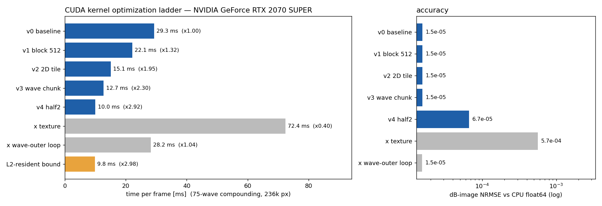
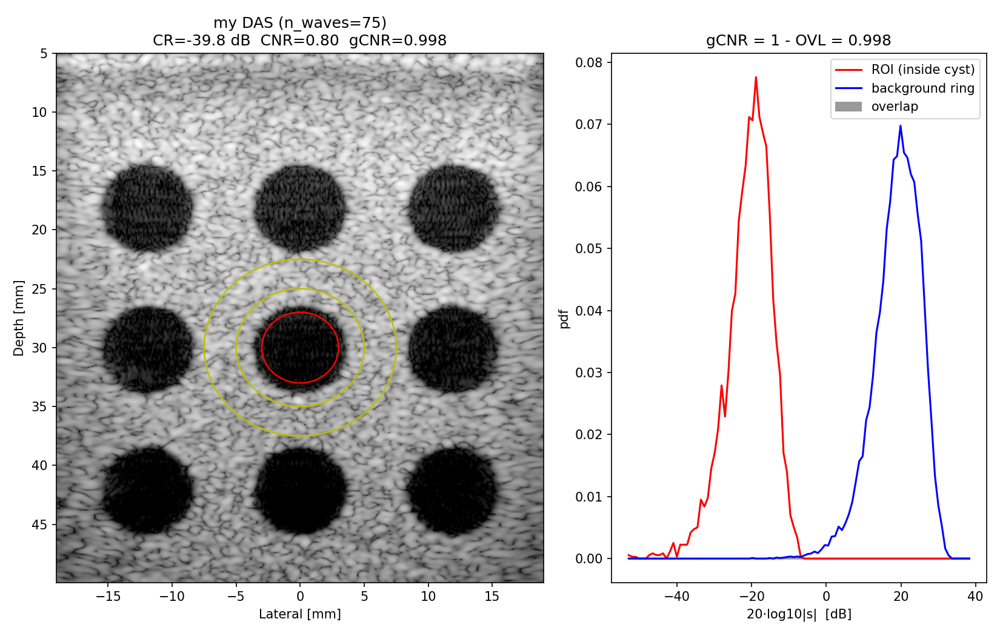
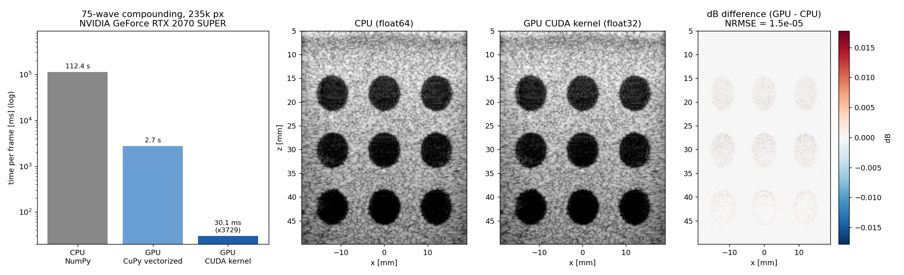
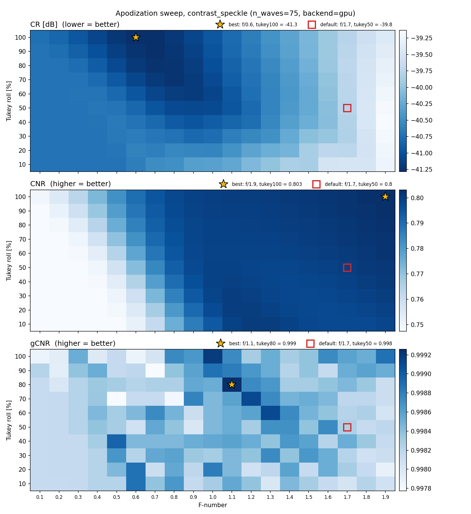
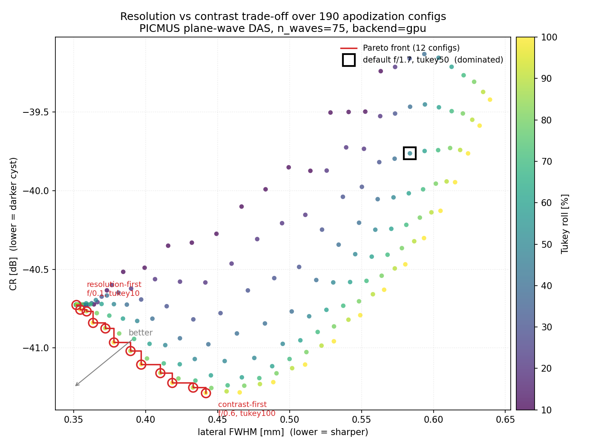

# PICMUS Plane-Wave DAS Beamformer — Python 구현 · CUDA GPU 가속

초음파 평면파(plane-wave) 채널 데이터로부터 **Delay-and-Sum(DAS) 빔포밍을 직접 구현**하고,
PICMUS 공개 데이터셋과 USTB 참조 영상에 대해 **정량 지표(FWHM, CR/CNR/gCNR)로 정확도를 검증**한 뒤,
**CUDA 커널로 GPU 가속**해 프레임당 112초 걸리던 처리를 12.7 ms로 줄인 프로젝트입니다.

MATLAB 기반 USTB(Ultrasound Toolbox)의 `midprocess.das` 로직을 참고해 포팅했으며,
MATLAB 라이선스 없이 `.uff`(HDF5) 파일을 직접 읽어 전 과정을 Python으로 재현했습니다.
GPU 버전은 CuPy `RawKernel`로 작성한 CUDA C 커널입니다.

---

## 핵심 결과

75개 평면파 coherent compounding, 236k pixels, dynamic receive apodization(F# = 1.7, Tukey 50%) 기준.

### 1. 성능 — CUDA GPU 가속 (§5)

| 구현 | 1 frame | CPU 대비 | dB NRMSE vs CPU |
|---|---|---|---|
| CPU NumPy (float64) | 112.4 s | 1× | — |
| GPU CUDA 커널 — 기본 포팅 (§5.2 v0) | 29.3 ms | 3,800× | 1.5 × 10⁻⁵ |
| **GPU CUDA 커널 — 최적화 (§5.2)** | **12.7 ms** | **8,800×** | **1.5 × 10⁻⁵** |

(RTX 2070 SUPER, GPU는 15회 median. 빔포밍 커널 시간 기준이며, RF 데이터의 GPU 전송 + Hilbert 변환은 별도 약 14~21 ms)

- **정확도 손실 없음**: GPU(float32)와 CPU(float64)의 dB 영상 오차가 10⁻⁵ 수준이고, CR/CNR/gCNR과 FWHM도 동일합니다.
- **병목을 진단하고 고쳤습니다**: 실효 처리량이 DRAM 이론 대역폭(448 GB/s)에 붙어 있는 것을 확인했고,
  데이터를 L2에 상주시키는 통제 실험으로 *캐시 재사용 부족*이 원인임을 확인했습니다.
  이어서 픽셀 2D 타일링과 평면파 단위 launch 분할로 **2.3배** 더 줄였습니다.
- **파라미터 탐색 시간**: F# × Tukey 190조합 스윕이 **5시간 52분 → 1분 14초**가 됐습니다 (§5.1).



### 2. 정확도 — USTB 참조 구현과 비교 (§3)

동일 데이터에 동봉된 **USTB 참조 빔포밍 결과와 비교**했습니다.

| 지표 | 내 구현 | USTB 참조 | 비고 |
|---|---|---|---|
| Axial FWHM (18 points 평균) | **0.418 mm** (1.41 λ) | 0.417 mm (1.41 λ) | 차이 0.2 % |
| Lateral FWHM (18 points 평균) | **0.584 mm** (1.97 λ) | 0.658 mm (2.23 λ) | 11 % 더 좁음 (§3.1) |
| CR | **−39.76 dB** | −39.56 dB | 차이 0.21 dB |
| CNR | **0.800** | 0.797 | 차이 0.4 % |
| gCNR | **0.9982** | 0.9980 | 차이 0.02 % |
| dB 영상 NRMSE vs 참조 | **0.0428** | — | 0에 가까울수록 일치 |

→ 축방향 해상도와 대조도 지표가 참조 구현과 **소수점 둘째 자리까지 일치**하므로,
지연 계산·보간·채널 합산·compounding 전 단계가 올바르게 구현되었다고 판단했습니다.

| 해상도 검증 | 대조도 검증 |
|---|---|
|  |  |

---

## 1. 데이터

[PICMUS](https://www.creatis.insa-lyon.fr/Challenge/IEEE_IUS_2016/) (Plane-wave Imaging Challenge in
Medical UltraSound, IEEE IUS 2016) 시뮬레이션 데이터 2종을 사용했습니다.

| 항목 | 값 |
|---|---|
| 프로브 | L11-4v, 128 elements, pitch 0.30 mm, aperture 38.1 mm |
| 송신 | 평면파 75개, 조향각 −16° ~ +16° |
| 샘플링 | fs = 20.832 MHz, f0 = 5.208 MHz (fs/4), c = 1540 m/s, λ = 0.2957 mm |
| Raw 데이터 | (75 waves, 128 channels, 1527 samples) |
| 스캔 격자 | 387 (x: −19.05 ~ 19.00 mm) × 609 (z: 5.00 ~ 49.95 mm), 약 236k pixels |
| `..._resolution_distortion.uff` | point target 팬텀 → 해상도(FWHM) 측정용 |
| `..._contrast_speckle.uff` | 무에코 낭종 + speckle 팬텀 → 대조도(CR/CNR/gCNR) 측정용 |

두 파일 모두 채널 데이터와 함께 **USTB가 직접 빔포밍한 `beamformed_data`(참조 영상)** 를 담고 있어,
별도 구현 없이 내 결과와 1:1로 대조할 수 있습니다. (`uffLoader.load_reference_bmode`)

> `.uff`는 HDF5 포맷이라 h5py로 읽을 수 있습니다. 단 MATLAB이 column-major이므로
> 배열 축 순서가 MATLAB `size()`와 반대로 보이고, 픽셀 순서도 z가 먼저 변하는 순서라
> `reshape(N_x, N_z).T` 로 (depth, lateral) 격자를 맞춰야 합니다. 이 부분이 포팅에서 가장 까다로웠습니다.

용량이 커서 저장소에는 포함하지 않았습니다. 받은 파일을 `data/PICMUS/` 아래에 두면 됩니다.

## 2. 구현

### 2.1 파이프라인 (`dasBeamform.py`)

```
RF channel data (75, 128, 1527)
  │
  ├─ 1. Hilbert 변환 (fast-time 축) ─────── analytic signal
  │      raw RF를 그대로 지연·보간하면 반송파 진동 때문에 보간 오차가 커진다.
  │      USTB도 analytic signal로 바꾼 뒤 지연을 적용한다.
  │
  ├─ 2. 수신 지연  τ_rx = √((x_elem − x_pixel)² + z_pixel²) / c      → (N_pixel, 128)
  ├─ 3. 송신 지연  τ_tx = (z_pixel·cos θ + x_pixel·sin θ) / c         → (N_pixel,)
  │
  ├─ 4. (τ_rx + τ_tx − t0)·fs → fractional sample index
  │      floor/frac 분해 후 선형보간, 범위를 벗어난 인덱스는 0으로 마스킹
  │
  ├─ 5. apodization 가중 후 채널 합산 (delay-and-sum)
  └─ 6. 75개 평면파 결과 합산 (coherent compounding)
  │
  └─→ envelope (|·|) → log compression (60 dB) → B-mode
```

픽셀 × 채널 전체를 2D 배열로 한 번에 처리하고, 평면파 루프만 남겼습니다.
`np.take_along_axis`로 채널별 fractional index를 벡터로 뽑아 내부 이중 루프를 제거했습니다.

### 2.2 Dynamic receive apodization

깊이에 따라 수신 개구(aperture)를 키우는 F-number 기반 가변 apodization을 구현했습니다.

- 픽셀 깊이 z에서 aperture half-width = `z / (2·F#)`
- 그 범위를 벗어난 채널은 0, 경계는 Tukey 창으로 완만하게 감쇠 (`tukey0` = boxcar ~ `tukey100`)
- 기본값 F# = 1.7, Tukey 50 % (USTB/PICMUS 데모 기본 설정과 동일)

### 2.3 정량 지표 (`metrics.py`)

정의는 USTB `tools.measure_contrast_circles.m` 와 동일하게 맞췄습니다.

| 지표 | 정의 |
|---|---|
| FWHM | 피크 기준 −6 dB 지점의 full width. 좌우 교차점을 **선형보간해 sub-pixel**로 계산 |
| CR | `10·log10( mean|s|²_ROI / mean|s|²_bg )` |
| CNR | `|mean_ROI − mean_bg| / √(var_ROI + var_bg)` (power 기준) |
| gCNR | `1 − OVL` (ROI/배경 dB 히스토그램 100 bin 겹침 면적). Rodriguez-Molares et al., 2020 |
| NRMSE | 두 dB 영상(각자 최대값 정규화, −60 dB clip) 간 RMSE / dynamic range |

## 3. 검증 결과 상세

### 3.1 해상도 — point target FWHM

`results/resolution_fwhm.csv` · 측정 point 18개 (축상 6점, z = 20/40 mm 가로줄 12점)

- **축방향 FWHM 0.409 ~ 0.428 mm (1.38 ~ 1.45 λ)** — 참조와 전 구간에서 일치.
  축방향 해상도는 송신 펄스 대역폭이 결정하므로, 지연·보간이 정확하면 참조와 같게 나오는 것이 맞습니다.
- **횡방향 FWHM 0.562 ~ 0.623 mm (1.90 ~ 2.10 λ)** — 전 시야에서 일관되나, 참조보다 평균 11 % 좁습니다.
  횡방향 폭은 유효 개구 폭이 결정하므로, 동봉된 참조 영상이 내 설정(F# 1.7 / Tukey 50)과
  다른 apodization으로 생성되어 유효 개구가 더 좁았을 가능성이 높습니다.
  → **확인 과제**: 참조 생성 스크립트의 apodization 설정 확인, F# 스윕으로 참조 FWHM과 일치하는 지점 역추적.
- 검출된 피크 위치는 18개 point 전부 참조 영상과 **동일 픽셀**에서 잡혔습니다.
  공칭 좌표 대비 축방향으로 약 +0.2 mm 치우쳐 있지만 참조도 같은 값이므로, 구현 오차가 아니라
  팬텀 공칭 좌표 목록과 실제 산란체 위치의 차이입니다.

### 3.2 대조도 — 무에코 낭종

`results/contrast_metrics.csv` · ROI 중심 (0, 30 mm), ROI r = 3 mm, 배경 링 5 ~ 7.5 mm
(USTB UiO IN4015 `PW_compounding.m` 기준)

CR, CNR, gCNR 세 지표 모두 참조와 0.5 % 이내로 일치했습니다 (표는 위 핵심 결과 참고).
gCNR 0.998은 낭종 내부와 주변 speckle의 밝기 분포가 거의 겹치지 않는다는 의미입니다.

## 4. 파라미터 스윕과 성능 현황

F# 0.1 ~ 1.9 (19단계) × Tukey 10 ~ 100 (10단계) = **190개 조합**을 전수 탐색해
apodization 파라미터가 영상에 미치는 영향을 관찰했습니다. (`runDasApodCompare.py` → `outputs/tukeyNN/`)

| 항목 | 측정값 |
|---|---|
| 1 frame (75-wave compounding, 236k pixels) | **약 109 초** (CPU, NumPy) |
| 190 조합 전수 탐색 | **5 시간 52 분** (21,121 초) |

→ 정확도는 확보했지만 **프레임당 109초는 실시간 영상(수십 fps)과 6자리 이상 차이**가 납니다.
현재 구현은 평면파마다 (236k × 128) 복소 배열을 생성·합산하므로 메모리 대역폭에 묶여 있습니다.

## 5. GPU 가속 (CuPy / CUDA)

`dasBeamformGpu.py` — 같은 알고리즘을 두 가지 방식으로 GPU에 올리고, `benchmark_gpu.py`로
CPU 결과와 처리시간·영상 일치도를 같이 비교했습니다. (RTX 2070 SUPER, 75파 compounding, 236k pixels)

| 구현 | 1 frame | CPU 대비 | NRMSE vs CPU | NRMSE vs USTB |
|---|---|---|---|---|
| CPU NumPy (float64) | 112.4 s | 1× | — | 0.0428 |
| GPU CuPy vectorized (CPU 코드 직역) | 2.73 s | 41× | 1.7 × 10⁻⁵ | 0.0428 |
| **GPU CUDA RawKernel** | **30.1 ms** | **3,729×** | **1.5 × 10⁻⁵** | 0.0428 |
| └ end-to-end (RF host → H2D → Hilbert → kernel → D2H) | 50.5 ms | 2,225× | | |

(contrast_speckle 기준, 10회 median. resolution_distortion도 29.0 ms / 3,869×로 같은 경향 — `results/gpu_benchmark.csv`)



- **CuPy 직역판이 41×에 그친 이유**: CPU와 같은 구조라 평면파마다 (236k × 128) 지연·인덱스·보간 임시 배열을
  수십 개 GPU 메모리에 쓰고 다시 읽습니다. 연산이 아니라 메모리 왕복이 병목이라 GPU로 옮겨도 이 한계가 그대로 남습니다.
- **CUDA 커널 (스레드 1개 = 픽셀 1개)**: 채널 × 평면파 루프 전체를 레지스터 안에서 누적해 임시 배열이 하나도 생기지 않습니다.
  추가로 ① 수신 지연 `sqrt`를 채널당 1번만 계산해 75개 평면파에 재사용, ② dynamic apodization 가중치를 커널 안에서
  즉석 계산(120 MB 가중치 맵 읽기 제거), ③ aperture 밖 채널(w = 0)은 메모리 접근 자체를 건너뜁니다.
  → 직역판 대비 다시 **90×**.
- **정밀도**: GPU는 float32/complex64로 계산합니다 (RTX 20xx의 FP64 처리량은 FP32의 1/32).
  지연을 [초]가 아닌 [샘플] 단위로 바꿔 계산해 float32로도 보간 위치 오차가 이론상 ~10⁻⁴ 샘플 수준이며, 실측으로
  CPU float64 결과와의 dB NRMSE 1.5 × 10⁻⁵, 복소 최대 상대오차 2 × 10⁻⁵ 입니다.
  CR / CNR / gCNR (−39.76 dB / 0.800 / 0.998)과 평균 FWHM (lateral 0.584 mm / axial 0.418 mm)도 CPU와 동일합니다.
- **의미**: 30 ms/frame ≈ **33 fps**로 실시간 영역에 들어왔고, §4의 190 조합 스윕(5시간 52분)은 이론상 약 6초면 끝납니다.

### 5.1 GPU로 190 조합 스윕 재실행 + 지표 기반 비교

`runDasApodCompare.py --backend gpu` — §4의 스윕을 CUDA 커널로 다시 돌리고, 설정마다 CR / CNR / gCNR을 계산했습니다.
hilbert(analytic signal)는 F#/Tukey와 무관하므로 루프 밖에서 1회만 계산해 190개 설정이 공유합니다.
CPU 결과(`timing_log.txt`, `outputs/tukeyNN/`)는 그대로 두고 GPU 결과는 `*_gpu` 경로에 따로 저장합니다.

| 항목 | CPU (2026-09-04) | GPU (CUDA RawKernel) |
|---|---|---|
| 190 조합 전체 | 5 시간 52 분 (21,121 s) | **1 분 13 초 (73.3 s)** |
| 설정당 빔포밍 | 약 111 s (hilbert·PNG 저장 포함) | **평균 67.6 ms** (D2H 포함) |
| 설정당 PNG 저장 | (위에 포함) | 약 0.31 s |
| hilbert | 설정마다 반복 | 1회 220 ms |

(`timing_log_gpu.txt`: 설정별 beamform / metrics / plot / total [ms], `results/apod_sweep_gpu.csv`)

GPU에서는 빔포밍 합계가 12.8초이고, 남은 시간의 대부분(58초)은 matplotlib PNG 저장입니다.
빔포밍 시간이 §5의 30 ms보다 긴 이유는 F#이 작을수록 aperture 안 채널이 많아져 커널 작업량이 늘고(f/0.1에서 약 71 ms),
설정마다 결과를 host로 내리는 시간까지 포함했기 때문입니다.



- **CR**: f/0.6, Tukey 100에서 −41.3 dB로 가장 좋았고, 기본값(f/1.7, Tukey 50)은 −39.8 dB입니다.
  F#이 커질수록(aperture가 좁아질수록) 낭종 안으로 새는 신호가 늘어 CR이 나빠집니다.
  f/0.3 이하에서는 aperture가 배열 전체보다 훨씬 넓어져 사실상 boxcar가 되므로 값이 평평합니다.
- **CNR**: 반대로 F#이 클수록 좋아지고(f/1.9에서 0.803) f/0.5 이하에서 0.75까지 떨어집니다.
  → CR과 CNR이 **F# 방향으로 trade-off** 관계입니다. 기본값 f/1.7은 CNR 쪽에 가까운 선택입니다.
- **gCNR**: 190개 전부 0.9978 ~ 0.9993으로 포화돼, 이 시뮬레이션 낭종에서는 설정 간 차이를 가려내지 못합니다
  (칸마다 들쭉날쭉한 패턴은 이 정도 미세한 차이에서 나오는 변동입니다).
- 기본값 f/1.7, Tukey 50의 CR / CNR / gCNR(−39.76 dB / 0.800 / 0.9983)은 §5 CPU 결과와 일치합니다.

### 5.2 CUDA 커널 최적화 — 병목 확인 후 단계별 개선

`dasKernelVariants.py`(변형 커널), `benchmark_kernels.py`(측정) — §5 커널에서 한 번에 한 가지씩 바꿔
처리시간과 CPU 대비 NRMSE를 같이 쟀습니다. (contrast_speckle, 15회 median, `results/kernel_opt.csv`)


| 단계 | 변경 | 1 frame | 누적 향상 | NRMSE vs CPU |
|---|---|---|---|---|
| v0 | §5 기준 커널 (1D 블록 128) | 29.3 ms | 1.00× | 1.5 × 10⁻⁵ |
| v1 | 블록 크기 512 | 22.1 ms | 1.32× | 1.5 × 10⁻⁵ |
| v2 | 픽셀 2D 타일 (깊이 32 × 가로 8줄, 블록 256) | 15.1 ms | 1.95× | 1.5 × 10⁻⁵ |
| **v3** | **평면파 15개씩 launch 분할** | **12.7 ms** | **2.30×** | **1.5 × 10⁻⁵** |
| v4 | analytic signal을 fp16(half2)으로 저장 | 10.0 ms | 2.92× | 6.7 × 10⁻⁵ |
| ✗ | 3D texture 하드웨어 선형보간 | 72.4 ms | 0.40× | 5.7 × 10⁻⁴ |
| ✗ | 루프 순서 바꾸기 (평면파 바깥, 채널 안쪽) | 28.2 ms | 1.04× | 1.5 × 10⁻⁵ |
| 하한선 | v1과 같은 연산, 데이터 전부 L2 상주 | 9.8 ms | 2.98× | — |

resolution_distortion에서도 v3 12.2 ms(2.38×), v4 10.0 ms(2.89×)로 같은 결과입니다.
v3까지는 정밀도 손실이 전혀 없어 **v3를 기본 설정**으로 채택했습니다 (`das_beamform_fast`, fp16은 `half=True` 선택).

**1) 병목 진단 — Nsight Compute 없이 통제 실험으로.**
보간 1회당 complex64 샘플 2개(16 B)를 읽는다고 계산하면 v0의 실효 처리량은 444 GB/s로,
RTX 2070 SUPER DRAM 이론 대역폭(448 GB/s)과 같았습니다. 이를 확인하려고 연산은 그대로 두고
75개 평면파가 모두 같은 0번 평면파 데이터(1.85 MB)만 읽게 바꾸자(L2 4 MB에 상주) **v1 대비 2.3배 빨라졌습니다** (22.1 → 9.8 ms).
→ 병목은 연산이 아니라 **DRAM 대역폭**이고, 원인은 같은 샘플을 여러 픽셀이 다시 읽는데도
캐시에서 재사용되지 못하는 것이었습니다 (전체 데이터 138 MB를 13 GB만큼 반복해서 읽음).

**2) 왜 재사용이 안 됐나.** 한 (평면파, 채널) 행의 샘플을 공유하는 건 *같은 깊이, 이웃한 가로 위치*의 픽셀들입니다.
그런데 v0는 블록이 깊이 방향 연속 픽셀이라 이웃 x 줄이 서로 다른 SM에 흩어지고,
동시에 도는 warp들도 제각각 다른 채널·평면파를 읽어 순간 작업 집합이 L2보다 커졌습니다.

**3) 해결.**
- **v2 2D 타일**: 블록을 깊이 32 × 가로 8줄로 묶어, 비슷한 샘플 구간을 읽는 이웃 x 픽셀을 같은 SM(L1)에 모았습니다.
  warp(32 스레드)는 여전히 한 x 줄의 연속 깊이라 메모리 접근 패턴은 그대로입니다.
- **v3 launch 분할**: 75개 평면파를 15개씩 5번의 커널 launch로 나눴습니다. launch 경계에서 GPU 전체가 동기화되므로
  한 launch가 읽는 데이터가 평면파 15장으로 제한됩니다. 픽셀마다 담당 스레드가 하나라 launch 사이 누적에 atomic이 필요 없습니다.
- 결과적으로 v3(12.7 ms)는 "데이터가 전부 L2에 있다면"의 하한선(9.8 ms)의 약 77% 수준까지 왔습니다.
  fp16(v4)은 읽는 바이트를 절반으로 줄여 하한선과 거의 같아지지만, CPU 대비 오차가 4배 커지는 trade-off입니다.

**4) 채택하지 않은 시도.**
- **Texture 하드웨어 보간**: 보간 가중치가 9-bit 고정소수점이라 오차가 37배 커지고,
  3D texture 캐시의 지역성 가정이 이 접근 패턴(채널마다 평면파 75장을 건너뛰며 읽기)과 맞지 않아 2.4배 느려졌습니다.
- **루프 순서 교환**: 평면파 바깥으로 돌리면 수신 지연 `sqrt`와 apodization을 75배 더 계산해야 하고,
  warp 간 진행 속도가 달라 기대한 L2 재사용도 생기지 않았습니다. 같은 아이디어를 커널 *밖*(launch 분할)에서 강제한 것이 v3입니다.

### 5.3 해상도 ↔ 대조도 트레이드오프 (CR vs FWHM 파레토 프론트)

§5.1의 190 조합을 `resolution_distortion` 데이터에도 그대로 돌려, 설정마다
point target 18개의 **횡/축 FWHM**을 재고 contrast 결과와 label로 조인했습니다.
(`runDasApodCompare.py --dataset resolution` → `runParetoFront.py`, GPU 190조합 **14.5 초**,
설정당 beamform 평균 48.7 ms. 18개 point 모두 전 설정에서 -6 dB 교차점 검출에 성공했습니다.)

FWHM과 CR은 **둘 다 작을수록 좋은** 지표라, 두 지표를 동시에 지배당하지 않는
비지배 집합(파레토 프론트)을 구했습니다.



| f# | Tukey | lateral FWHM [mm] | CR [dB] | CNR | gCNR | 비고 |
|---|---|---|---|---|---|---|
| 0.1 | 10 | 0.352 | -40.72 | 0.747 | 0.9981 | 해상도 우선 |
| 0.1 | 100 | 0.354 | -40.75 | 0.749 | 0.9979 | |
| 0.2 | 90 | 0.359 | -40.77 | 0.751 | 0.9979 | |
| 0.2 | 100 | 0.363 | -40.84 | 0.755 | 0.9979 | |
| 0.3 | 90 | 0.372 | -40.87 | 0.759 | 0.9984 | |
| 0.3 | 100 | 0.378 | -40.96 | 0.763 | 0.9985 | |
| 0.4 | 90 | 0.389 | -41.02 | 0.769 | 0.9985 | |
| 0.4 | 100 | 0.397 | -41.10 | 0.773 | 0.9980 | |
| 0.5 | 90 | 0.410 | -41.16 | 0.779 | 0.9981 | |
| 0.5 | 100 | 0.418 | -41.22 | 0.782 | 0.9981 | |
| 0.6 | 90 | 0.433 | -41.25 | 0.788 | 0.9982 | |
| 0.6 | 100 | 0.442 | -41.29 | 0.790 | 0.9979 | 대조도 우선 |

190개 중 프론트에 남은 것은 12개이고, 전부 **낮은 F-number(0.1~0.6) + 넓은 Tukey(90~100)** 구간입니다.

**1) 트레이드오프가 실제로 존재하는 구간은 좁습니다.**
프론트 양 끝의 차이는 CR 0.57 dB 대 횡방향 FWHM 26 %입니다.
즉 대조도 0.57 dB를 더 얻으려면 횡방향 해상도를 0.352 → 0.442 mm로 내줘야 합니다.

**2) 프론트 바깥에서는 트레이드오프가 아니라 양쪽이 같이 나빠집니다.**
F-number를 키우면 유효 구경이 좁아져 FWHM은 단조 증가(f/0.1 평균 0.352 mm → f/1.9 평균 0.605 mm)하는데,
CR은 단조가 아니라 **f/0.8 부근(평균 -40.99 dB)에서 가장 좋고 그 뒤로 다시 나빠집니다**(f/1.9 평균 -39.25 dB).
f/0.8을 넘어서면 해상도와 대조도가 동시에 손해라, 이 구간의 설정은 전부 지배당합니다.

**3) 기존 기본 설정 f/1.7 · tukey50은 프론트 위가 아닙니다.**
FWHM 0.584 mm, CR -39.76 dB로, **190개 중 151개 설정이 두 지표 모두에서 더 낫습니다.**
예를 들어 f/0.6 · tukey100으로 바꾸면 FWHM 0.442 mm(-24 %), CR -41.29 dB(1.53 dB 개선)로
어느 쪽도 손해 보지 않고 옮겨갈 수 있습니다.

**4) 해석할 때의 단서.**
- gCNR은 190개 설정이 0.9978 ~ 0.9993 안에 몰려(변동 폭 0.0015) 사실상 포화라, 이 격자에서는 설정을 구분하지 못합니다.
  판별력이 있는 것은 CR과 CNR 쪽입니다.
- 낮은 F-number가 이기는 것은 이 데이터가 **수차(aberration) 없는 시뮬레이션**이기 때문으로 보입니다.
  구경을 넓게 열수록 이득이고 손해가 거의 없는 조건입니다. 실측 데이터(PICMUS experimental)에서는
  가장자리 채널의 수차·SNR 저하 때문에 최적 F-number가 올라갈 가능성이 큽니다 — 다음 단계의 확인 과제입니다.

원자료: `results/pareto_cr_fwhm.csv`(설정별 조인 결과 + 프론트 여부),
`results/apod_sweep_resolution_gpu_points.csv`(설정 × point 18개 FWHM),
`results/apod_sweep_resolution_gpu_heatmap.png`(f# × Tukey FWHM 히트맵).

### 다음 단계

- [x] ~~**성능 최적화**: CuPy 기반 GPU 포팅 → before/after 처리시간 및 영상 일치도(NRMSE) 동시 보고~~ (§5)
- [x] ~~CUDA 커널 추가 최적화: 병목 확인 후 단계별 개선~~ (§5.2, 29.3 → 12.7 ms, 정밀도 동일)
- [ ] Nsight Compute로 §5.2의 진단(DRAM 대역폭 병목, L2 hit rate 변화)을 하드웨어 카운터로 재확인
- [x] ~~GPU 커널로 F# / Tukey 190 조합 스윕 재실행~~ (§5.1)
- [ ] 횡방향 FWHM 차이 원인 규명 (§3.1 확인 과제)
- [x] ~~F# / Tukey 스윕 결과를 PNG 눈으로 보는 대신 **지표 기반으로 정량 비교**~~ (§5.1, CR/CNR/gCNR 히트맵)
- [x] ~~같은 스윕에 resolution_distortion 데이터의 FWHM 추가 (CR ↔ 해상도 trade-off 확인)~~ (§5.3)
- [ ] 실측 데이터(PICMUS experimental)로 확장

## 6. 실행 방법

```bash
pip install -r requirements.txt          # numpy, scipy, h5py, matplotlib

# 단일 B-mode 영상 생성
python runDas.py

# 정량 검증 (CSV + 그림을 results/ 에 저장)
python validate_resolution.py --n-waves 75
python validate_contrast.py   --n-waves 75

# 평면파 1장씩 개별 빔포밍 (compounding 효과 확인용, outputs/per_wave/)
python runDasPerWave.py

# apodization 파라미터 스윕 190조합 (GPU 약 1분, CPU 약 6시간)
#   --dataset contrast   : contrast_speckle 에서 CR / CNR / gCNR 히트맵
#   --dataset resolution : resolution_distortion point target 18개의 FWHM 히트맵
python runDasApodCompare.py --dataset contrast   --backend gpu   # --no-png: 설정별 B-mode PNG 생략
python runDasApodCompare.py --dataset resolution --backend gpu
python runDasApodCompare.py --dataset contrast   --backend cpu
#   --limit N : 앞쪽 N개 설정만 돌리는 동작 확인용

# 두 스윕 결과를 묶어 CR vs FWHM 파레토 프론트 (해상도 ↔ 대조도 trade-off)
python runParetoFront.py --backend gpu               # --metric fwhm_ax_mm : 축방향 기준

# 위 스윕 2종 + 파레토를 순서대로 실행 (결과 CSV가 있는 단계는 건너뜀, --force로 재실행)
python runSweeps.py --backend gpu

# CPU vs GPU 처리시간 / 일치도 비교 (NVIDIA GPU + cupy 필요, results/gpu_benchmark.{csv,png})
python benchmark_gpu.py --n-waves 75 --repeats 10
python benchmark_gpu.py --skip-cpu       # CPU(약 2분/데이터) 생략하고 GPU만

# CUDA 커널 최적화 단계별 비교 (첫 실행 시 CPU 기준 영상을 outputs/에 캐시, results/kernel_opt.{csv,png})
python benchmark_kernels.py
```

GPU 버전은 `pip install "cupy-cuda12x[ctk]"` 로 CUDA 런타임까지 함께 설치되며, CUDA Toolkit을 따로 깔 필요는 없습니다.

`--n-waves 1` 을 주면 0° 단일 평면파만 사용해 빠르게 동작을 확인할 수 있습니다.

## 7. 파일 구조

```
.
├── uffLoader.py              # PICMUS .uff(HDF5) 로더 + USTB 참조 영상 로더
├── dasBeamform.py            # DAS 빔포밍 본체, dynamic apodization, B-mode 변환
├── dasBeamformGpu.py         # GPU 버전: CuPy vectorized + CUDA RawKernel
├── benchmark_gpu.py          # CPU vs GPU 처리시간·NRMSE 비교 → results/gpu_benchmark.{csv,png}
├── dasKernelVariants.py      # CUDA 커널 최적화 변형 (2D 타일, launch 분할, fp16, texture) + das_beamform_fast
├── benchmark_kernels.py      # 커널 최적화 단계별 비교 → results/kernel_opt.{csv,png}
├── metrics.py                # FWHM / CR / CNR / gCNR / NRMSE 계산
├── validate_resolution.py    # 해상도 검증 진입점  → results/resolution_fwhm.{csv,png}
├── validate_contrast.py      # 대조도 검증 진입점  → results/contrast_metrics.{csv,png}
├── runDas.py                 # 단일 B-mode 생성
├── runDasPerWave.py          # 평면파별 개별 빔포밍
├── runDasApodCompare.py      # apodization 파라미터 스윕 (--dataset contrast|resolution, --backend gpu|cpu)
│                             #   → results/apod_sweep_{suffix}.{csv,_heatmap.png}, resolution은 point별 원자료 CSV도 저장
├── runParetoFront.py         # 두 스윕을 조인해 CR vs FWHM 파레토 프론트 → results/pareto_cr_fwhm.{csv,png} + pareto_summary.md
├── runSweeps.py              # 스윕 2종 + 파레토를 순서대로 실행하는 엔트리포인트 (단계별 skip/force)
├── timing_log.txt            # CPU 스윕 190회 처리시간 기록 (2026-09-04)
├── timing_log_gpu.txt        # GPU 스윕 190회 처리시간 기록 (beamform / metrics / plot 분리)
├── results/                  # 정량 검증 결과 (CSV, 그림)
├── outputs/                  # 생성 영상 (git 제외)
└── data/PICMUS/              # 데이터셋 (git 제외, 별도 다운로드)
```

## 8. 참고

- H. Liebgott et al., "Plane-wave imaging challenge in medical ultrasound (PICMUS)," *IEEE IUS*, 2016.
- A. Rodriguez-Molares et al., "The UltraSound ToolBox," *IEEE IUS*, 2017. — [ustb.no](https://www.ustb.no/)
- A. Rodriguez-Molares et al., "The Generalized Contrast-to-Noise Ratio: A Formal Definition for
  Lesion Detectability," *IEEE TUFFC*, 2020.
- USTB `midprocess/das.m`, `tools/measure_contrast_circles.m`, UiO IN4015 `PW_compounding.m`
